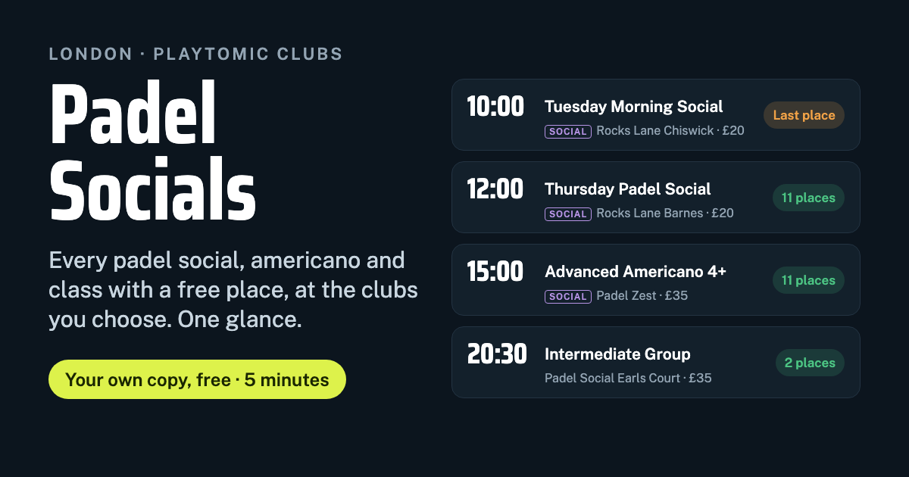

# Padel Socials: London padel socials, americanos and classes with free places

**Every padel social, americano and group class that still has a free place, at the London Playtomic clubs you choose, on one page.** Your own private copy, free, in about five minutes.

> **Heads-up:** Playtomic hasn't approved third-party tools that read its website, and says automated access may be limited or blocked, so Padel Socials may stop working at any time.

[](https://vercel.com/new/clone?repository-url=https%3A%2F%2Fgithub.com%2Fxternal%2Fpadel-socials&project-name=padel-socials&repository-name=padel-socials&env=PADEL_KEY&envDescription=Make%20up%20a%20long%20password.%20You%20type%20it%20once%20on%20your%20phone%20to%20open%20your%20feed.&envLink=https%3A%2F%2Fgithub.com%2Fxternal%2Fpadel-socials%23your-key)

<a href="https://ko-fi.com/pavelg"></a>



Live example and setup help: **https://padel-socials.vercel.app**

## What it does

Booking a padel social in London usually means opening Playtomic, picking a club, scrolling its activities, then doing the same for the next club. Padel Socials does that for you and shows the result at a glance:

- **Socials, americanos and tournaments** (weeks ahead) and **public group classes** (about 10 days ahead) that still have places
- at **up to 8 of 30 London clubs** at a time: Padel Social Club Earls Court, Paddington and The O2, Rocks Lane Chiswick, Barnes and Dyrham Park, Padel Zest, Padel Play London, S3 Padel, Powerleague, Padel People Wimbledon, Padel Box Bermondsey and more
- with **date, time, length, level range, places taken, coach and price**, and the **next open spot** at the top
- filtered by **socials or classes, club, and your Playtomic level**
- each event links to its **Playtomic page**, where you book as usual, plus **Directions** in Google Maps
- automatic **light and dark mode**, and it adds to your phone's home screen like an app

It doesn't book anything and never needs your Playtomic login.

## Get your own copy (free, about 5 minutes)

1. Press **Deploy** above and sign in to [Vercel](https://vercel.com) with GitHub. Both have free plans that are plenty.
2. Vercel copies this project into your GitHub account and asks for one setting, `PADEL_KEY` (see below).
3. When the deploy finishes, open your new site (something like `padel-socials-yourname.vercel.app`) and type your key once. Your phone remembers it.
4. Tap **Choose clubs**, set **My level**, and add the page to your home screen.

### Your key

`PADEL_KEY` is a password you make up, for example four random words. It keeps your feed private: without it the page shows only the setup help. You can change it any time in your Vercel project under Settings → Environment Variables, then redeploy.

## Use it from the terminal

With [Node.js](https://nodejs.org) 18 or newer:

```bash
node cli.mjs                                   # your default clubs, next 60 days, only events with places
node cli.mjs --socials --days 7                # socials in the next week
node cli.mjs --list                            # every club and its slug
node cli.mjs --clubs padel-zest,rocks-lane-chiswick
```

## Add or change clubs

The clubs live in [`clubs.json`](clubs.json). Each one needs the `slug` from its Playtomic address (`playtomic.com/clubs/<slug>`), a `name` and an `area`. Mark the ones you want selected by default with `"default": true`. Any Playtomic club works, not just London ones.

## How it works

- Two public pages per club: `playtomic.com/clubs/<slug>/academy/public-classes` and `playtomic.com/clubs/<slug>/competitions/tournaments`. Neither is blocked in Playtomic's `robots.txt`.
- Those pages are built with Next.js server components, so part of each card is only in the page's embedded component stream (`self.__next_f`). [`api/_playtomic.js`](api/_playtomic.js) decodes that stream so every card is complete.
- [`api/feed.js`](api/feed.js) is a Vercel serverless function. It checks your key, reads the clubs you picked (up to 8), keeps each club's result for 5 minutes, and returns only events with places. On a slow day Playtomic takes 20–40 seconds to build a club page, so it waits up to 50 seconds per page.
- [`index.html`](index.html) is a single static page with no framework and no build step. Your phone keeps the last good list for each club, so the page opens at once and still shows something (marked with the time it was read) when Playtomic is too slow to answer.

## Fair use

Playtomic's terms allow personal, non-commercial use of their website. Each copy of Padel Socials reads public club pages for its owner alone, so:

- keep your copy's link and key to yourself,
- don't turn it into a public or paid service,
- leave the caching in place so a copy asks Playtomic for each club at most every few minutes.

Padel Socials is not affiliated with, endorsed by or connected to Playtomic. Playtomic hasn't approved third-party tools that read its website, and says automated access may be limited or blocked, so Padel Socials may stop working at any time.

## FAQ

**Is it free?** Yes. The code is MIT-licensed and Vercel's free plan is enough.

**Does it show full sessions?** No. Playtomic leaves full events off these pages, so everything listed has at least one place.

**Can it book for me or join a waitlist?** No, on purpose. Tap the event and book in Playtomic.

**What about open matches?** Playtomic only shows open matches inside its app, so they aren't included.

**Does it work outside London?** Yes. Add any Playtomic club to `clubs.json`.

## Support

If Padel Socials saved you some scrolling, a matcha keeps it going:

<a href="https://ko-fi.com/pavelg"></a>

Ideas, bugs or a club to add: **ideas@guzh.uk**

## Credits and licence

Made by [Pavel Guzhikov](https://guzh.uk). Sister project: [Where to Padel](https://where-to-padel.vercel.app), live padel group sessions with free spaces at David Lloyd clubs near any UK postcode.

[MIT licence](LICENSE).
